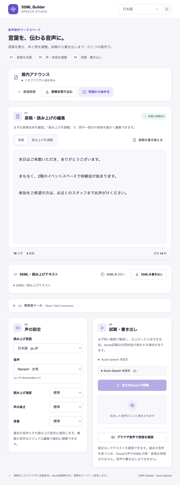

# SSML-Builder

[日本語](#日本語) · [English](#english) · [開発 / Development](#development)

## 日本語

Azure Speech 向けの SSML を生成・解析・編集し、音声に変換する TypeScript ライブラリです。
React エディター、Web Component、音声制作用の Playground を提供します。

### インストール

```sh
npm install ssml-builder-js
```

用途に応じて、次のサブパスから読み込みます。

| インポート | 機能 |
| --- | --- |
| `ssml-builder-js` | SSML コア機能と Azure TTS クライアント |
| `ssml-builder-js/core` | SSML の生成・解析・検証・テキスト変換 |
| `ssml-builder-js/react` | React のコード／ビジュアルエディター |
| `ssml-builder-js/elements` | フレームワーク非依存の `<ssml-editor>` |

React エディターには React 18.2 以上・20 未満と Monaco アダプターが必要です。
Web Component には Monaco Editor が必要です。

```sh
# React
npm install ssml-builder-js @monaco-editor/react react react-dom
# Web Component
npm install ssml-builder-js monaco-editor
```

### Playground：原稿から音声を制作



テンプレートやテキスト／SSML の取り込みから始め、声・速度・高さ・音量を調整できます。
コード／ビジュアル編集、全文・選択範囲の Azure 試聴、SSML・MP3 の書き出しに対応します。
表示言語は9言語に対応し、ライト／ダークテーマを切り替えられます。

[開発環境のセットアップ](#development)後、リポジトリのルートで実行します。

```sh
cp apps/playground/.env.example apps/playground/.env.local
npm run dev --workspace playground
```

Azure 試聴には `.env.local` の `AZURE_SPEECH_KEY` と `AZURE_SPEECH_REGION` を設定してください。
`AZURE_SPEECH_ENDPOINT` は任意です。キーはサーバー側で扱い、原稿は合成時にサーバーと Azure へ送信します。
Azure 未設定でもブラウザーの音声で本文を確認できますが、SSML の表現や音声の書き出しには対応しません。

原稿名と SSML はブラウザーの `localStorage` に自動保存します。共有端末で機密原稿を扱う場合は注意してください。
「原稿を編集」で本文を作り直すと、最初の声・速度・高さ・音量を引き継ぎ、部分ごとの間や表現は解除します。
直前の原稿へ戻すこともできます。

<a id="ssml-core"></a>

### SSML を生成・解析する

`SsmlDocument` の `children` にテキストや要素を指定します。
XML のエスケープと Azure 拡張要素の名前空間は自動で処理します。

```ts
import { buildSsml, parseSsml, validateAzureSsml } from "ssml-builder-js/core";
import type { SsmlDocument } from "ssml-builder-js/core";

const document: SsmlDocument = {
  version: "1.0",
  lang: "ja-JP",
  children: [
    {
      type: "voice",
      name: "ja-JP-NanamiNeural",
      children: [
        { type: "prosody", rate: "slow", children: ["こんにちは。"] },
        { type: "break", time: "300ms" },
        "SSML Builder です。",
      ],
    },
  ],
};

const ssml = buildSsml(document);
const parsed = parseSsml(ssml);
const diagnostics = await validateAzureSsml(ssml);
```

| API | 用途 |
| --- | --- |
| `buildSsml(document)` / `parseSsml(xml)` | 型付きドキュメントと XML の相互変換 |
| `buildPartialSsml(text, context?)` / `buildPartialSsml({ text, ...context })` | 声・言語・韻律を引き継いだ部分 SSML の生成 |
| `fromPlainTextToSsml(text, options?)` | テキストから段落・文を含む SSML を生成 |
| `extractSsmlText(xml)` / `mapSsmlTextNodes(xml, transform, options?)` | 本文の抽出／タグ構造を保った同期・非同期変換 |
| `extractSsmlTranslatableText(xml, options?)` / `validateSsmlStructureIntegrity(original, translated)` | 翻訳対象の抽出／変換前後のタグ・属性の検証 |
| `splitSsmlDocument(xml, maxChars, options?)` | 親の声・韻律を保った長文分割 |
| `validateSsml(xml)` | 構文エラーを `{ message, position }` または `null` で返す |
| `validateAzureSsml(xml, options?)` / `validateAzureSsmlChunks(chunks, options?)` | Azure 向けの静的診断を返す |

`voice`、`prosody`、`break`、`say-as`、`phoneme`、`audio` などの標準要素と、
`mstts:express-as`、対話、背景音声などの Azure 拡張に対応します。未定義の要素は `type: "custom"` で扱えます。
型と全APIは [コアの公開エントリー](./packages/ssml-core/src/index.ts)から確認できます。

構文検証と Azure 向けの静的検証は、実際の合成成功を保証しません。
音声の提供状況はリージョンやサービス更新で変わるため、`voiceDefinitions` で外部カタログを渡せます。
外部音声 URL は既定で拒否します。許可する場合は `allowedAudioOrigins` を指定し、
サーバー側でも URL・リダイレクト先・プライベート IP・応答サイズを制限してください。

<a id="ssml-editor-react"></a>

### React で編集する

`SsmlEditor` は Monaco によるコード編集と、構造ツリー・フォームによるビジュアル編集を提供します。
間・速度・ピッチ・感情・読み方をツールバーから調整でき、構文や Azure 対応の診断を表示します。
UI は日本語・英語に対応し、ツールバーと挿入メニューはキーボードでも操作できます。

```tsx
"use client";

import { useState } from "react";
import { SsmlEditor } from "ssml-builder-js/react";
import type { SsmlDocument } from "ssml-builder-js/core";

const initialDocument: SsmlDocument = {
  version: "1.0",
  lang: "ja-JP",
  children: ["編集する本文"],
};

export function App() {
  const [document, setDocument] = useState(initialDocument);
  return <SsmlEditor document={document} onChange={setDocument} locale="ja" />;
}
```

| 主な props | 用途 |
| --- | --- |
| `document` / `onChange` / `onSsmlChange` | ドキュメントの入力／変更通知／生成 XML の通知 |
| `editMode` / `locale` | `"code"`・`"visual"` の切り替え／UI 言語（`"ja"` が既定、`"en"` も対応） |
| `onSelectionChange` / `onPreviewSelection` | 選択状態の通知／選択部分の SSML を使った試聴の実装 |
| `editorOptions` | 高さ、読み取り専用、テーマ、文字サイズなどの Monaco 設定 |
| `showToolbar` / `showToolbarIcons` / `showToolbarLabels` / `buttonVisibility` | ツールバー・アイコン・ラベル・個別ボタンの表示 |
| `showDecorations` / `enableCodeLens` | インライン装飾（既定 `false`）／クイック操作（既定 `true`） |
| `toolbarOrder` / `toolbarGroups` / `insertionOrder` / `insertionGroups` | 操作の順序とグループ構成 |
| `customInsertions` / `additionalInsertions` / `emotionStyles` | 標準挿入定義の置き換え／追加／感情候補 |
| `voiceCatalog` / `voiceCatalogMetadata` / `voiceModel` | 音声候補とカタログの鮮度・対応モデルの診断 |
| `customInspectors` / `renderVoiceSelector` | ビジュアル編集フォーム・音声選択の差し替え |

`ref` の `SsmlEditorRef` には `getFullSsml()`、`getSelectedSsml()`、`getCurrentLineSsml()` があります。
選択がない場合は現在行を使い、対象が空なら後者2つは `null` を返します。
`onPreviewSelection` は声・韻律などを引き継いだ部分 SSML を受け取ります。音声の合成・再生はアプリ側で実装します。
`document.lang` は読み上げ言語、`locale` は表示言語です。

標準挿入定義は `SSML_INSERTIONS` から参照できます。カスタム定義は配列または ID をキーにしたオブジェクトで指定し、
`createSsmlEditorInsertionDefinition`、または複数属性を扱う `createTemplate` で作成します。
全 props・ref・挿入型は [SsmlEditor.tsx](./packages/ssml-editor-react/src/SsmlEditor.tsx)を参照してください。

Next.js ではクライアントコンポーネント内で `next/dynamic` の `ssr: false` を使います。
[エディターの組み込み例](./apps/playground/app/components/NextSsmlEditor.tsx)と
[サーバー側の検証・合成例](./apps/playground/app/api/synthesize/route.ts)を参照してください。

<a id="ssml-editor-elements"></a>

### Web Component で編集する

ブラウザーで `ssml-builder-js/elements` を読み込むと、`<ssml-editor>` が登録されます。

```html
<ssml-editor locale="ja" edit-mode="visual" style="display: grid; min-height: 24rem;"></ssml-editor>
```

```ts
import "ssml-builder-js/elements";
import type { SsmlEditorElement } from "ssml-builder-js/elements";

const editor = document.querySelector<SsmlEditorElement>("ssml-editor");
if (editor) {
  editor.value = '<speak version="1.0" xml:lang="ja-JP">編集する本文</speak>';
}
```

`value`、`theme`、`readonly`、`locale`、`edit-mode` で編集内容と表示を設定します。
変更は `change` イベントの `detail: { value }`、ビジュアル試聴は `preview-selection` の `detail: { ssml }` で受け取れます。
ツールバーの展開に合わせて高さが増えるレイアウトを使ってください。
全設定は [SsmlEditorElement.ts](./packages/ssml-editor-elements/src/SsmlEditorElement.ts)を参照してください。

<a id="azure-tts-client"></a>

### Azure で音声を生成する

Azure の認証情報をサーバー環境変数に設定し、`AzureTtsClient` に渡します。
検証付きの `synthesizeSsmlSafe` は、静的検証エラーがあれば Azure を呼び出さずに結果を返します。

```ts
import { AzureTtsClient } from "ssml-builder-js";
import { fromPlainTextToSsml } from "ssml-builder-js/core";

const client = new AzureTtsClient({
  subscriptionKey: process.env.AZURE_SPEECH_KEY!,
  region: process.env.AZURE_SPEECH_REGION!,
  timeoutMs: 15_000,
});
const ssml = fromPlainTextToSsml("こんにちは。", {
  lang: "ja-JP",
  voice: "ja-JP-NanamiNeural",
});
const result = await client.synthesizeSsmlSafe(ssml);
if (result.ok) {
  const { audioData, durationMs, boundaries, visemes, bookmarks } = result.value;
} else {
  console.error(result.error.kind);
}
```

| API | 戻り値・用途 |
| --- | --- |
| `client.synthesize(ssml)` | 音声の `ArrayBuffer` |
| `client.synthesizeSsml(ssml, options?)` | 音声と長さ・単語境界・口形・ブックマークの同期情報 |
| `client.synthesizeSsmlSafe(ssml, options?)` | 検証付きの成功／失敗結果 |
| `client.synthesizeChunks(chunks, options?)` / `client.synthesizeChunksSafe(chunks, options?)` | 長文を分割合成し、音声と同期情報を結合 |
| `synthesizeSpeech(ssml, config)` / `synthesizeSsml(ssml, config)` | `endpoint`・キー・リージョンを渡す関数形式 |
| `synthesizeSsmlSafe(client, ssml, options?)` / `synthesizeSsmlChunksSafe(client, chunks, options?)` | 検証付きの関数形式 |
| `fetchAzureVoiceCatalog(options)` | 指定リージョンの音声一覧とメタデータを取得 |

既定の音声形式は `audio-16khz-128kbitrate-mono-mp3` です。
`outputFormat`、`signal`、`timeoutMs` で形式・キャンセル・制限時間を設定できます。
チャンク合成は `concurrency`、`retryOptions`、`onProgress`、`resumeChunks` に対応します。
手動で結合する `mergeAudioBuffers` / `mergeSynthesisResults` には `{ format }` を指定します。
自動結合に対応しない形式は `customMerger` を使用してください。
詳細は [TTS の型定義](./packages/azure-tts-client/src/types.ts)と
[検証付き API](./packages/azure-tts-client/src/safe.ts)を参照してください。

音声カタログの取得は CLI でも実行できます。キーは `AZURE_SPEECH_KEY` から読み込みます。

```sh
npx ssml-builder sync-voices --region japaneast --output ./azure-voices.json
```

サブスクリプションキーをブラウザーへ渡したり、キーや SSML 本文をログへ出力したりしないでください。
公開する合成 API では入力をサーバー側で検証してください。Azure の利用には料金が発生する場合があります。

## English

A TypeScript library for building, parsing, editing, and synthesizing SSML for Azure Speech.
Includes a React editor, a Web Component, and a speech production playground.

### Install

```sh
npm install ssml-builder-js
```

Choose the entry point for your use case.

| Import | Features |
| --- | --- |
| `ssml-builder-js` | SSML core utilities and the Azure TTS client |
| `ssml-builder-js/core` | SSML building, parsing, validation, and text transforms |
| `ssml-builder-js/react` | React code and visual editors |
| `ssml-builder-js/elements` | Framework-independent `<ssml-editor>` |

The React editor requires React 18.2 or later, below 20, and the Monaco adapter.
The Web Component requires Monaco Editor.

```sh
# React
npm install ssml-builder-js @monaco-editor/react react react-dom
# Web Component
npm install ssml-builder-js monaco-editor
```

### Playground: produce speech from a script


Start from a template or import text/SSML, then adjust the voice, rate, pitch, and volume.
Use code or visual editing, preview the full script or a selection with Azure, and export SSML or MP3.
The UI supports nine languages and light/dark themes.

After [setting up the development environment](#development), run from the repository root:

```sh
cp apps/playground/.env.example apps/playground/.env.local
npm run dev --workspace playground
```

For Azure preview, set `AZURE_SPEECH_KEY` and `AZURE_SPEECH_REGION` in `.env.local`.
`AZURE_SPEECH_ENDPOINT` is optional. Credentials stay on the server; synthesis sends the script to the server and Azure.
Without Azure credentials, browser speech can read the text, but it cannot reproduce SSML expression or export audio.

The script title and SSML are saved automatically in browser `localStorage`; take care with confidential scripts on shared devices.
**Edit script** rebuilds the text, preserving the first voice, rate, pitch, and volume while removing local pauses and expression.
You can restore the previous script.

### Build and parse SSML

Put text and elements in `SsmlDocument.children`.
XML escaping and namespaces for Azure extensions are handled automatically.

```ts
import { buildSsml, parseSsml, validateAzureSsml } from "ssml-builder-js/core";
import type { SsmlDocument } from "ssml-builder-js/core";

const document: SsmlDocument = {
  version: "1.0",
  lang: "en-US",
  children: [
    {
      type: "voice",
      name: "en-US-JennyNeural",
      children: [
        { type: "prosody", rate: "slow", children: ["Hello."] },
        { type: "break", time: "300ms" },
        "This is SSML Builder.",
      ],
    },
  ],
};

const ssml = buildSsml(document);
const parsed = parseSsml(ssml);
const diagnostics = await validateAzureSsml(ssml);
```

| API | Purpose |
| --- | --- |
| `buildSsml(document)` / `parseSsml(xml)` | Convert between typed documents and XML |
| `buildPartialSsml(text, context?)` / `buildPartialSsml({ text, ...context })` | Build partial SSML with inherited voice, language, and prosody |
| `fromPlainTextToSsml(text, options?)` | Convert text to SSML with paragraphs and sentences |
| `extractSsmlText(xml)` / `mapSsmlTextNodes(xml, transform, options?)` | Extract text or transform it synchronously/asynchronously while preserving tags |
| `extractSsmlTranslatableText(xml, options?)` / `validateSsmlStructureIntegrity(original, translated)` | Extract translation targets and check that tags and attributes are preserved |
| `splitSsmlDocument(xml, maxChars, options?)` | Split long documents while preserving parent voice and prosody |
| `validateSsml(xml)` | Return a syntax error as `{ message, position }`, or `null` |
| `validateAzureSsml(xml, options?)` / `validateAzureSsmlChunks(chunks, options?)` | Return static diagnostics for Azure |

Supports standard elements such as `voice`, `prosody`, `break`, `say-as`, `phoneme`, and `audio`,
plus Azure extensions for expression, dialogue, and background audio. Use `type: "custom"` for undefined elements.
See the [core public entry point](./packages/ssml-core/src/index.ts) for types and the full API.

Syntax and static Azure validation do not guarantee successful synthesis.
Voice availability varies by region and service updates; supply an external catalog through `voiceDefinitions`.
External audio URLs are rejected by default. To allow them, set `allowedAudioOrigins` and also enforce server-side
limits on URLs, redirects, private IP addresses, and response sizes.

### Edit in React

`SsmlEditor` provides Monaco code editing and visual editing with a structure tree and forms.
Adjust pauses, rate, pitch, emotion, and pronunciation through the toolbar and view syntax/Azure diagnostics.
The UI supports Japanese and English, with keyboard navigation for the toolbar and insertion menus.

```tsx
"use client";

import { useState } from "react";
import { SsmlEditor } from "ssml-builder-js/react";
import type { SsmlDocument } from "ssml-builder-js/core";

const initialDocument: SsmlDocument = {
  version: "1.0",
  lang: "en-US",
  children: ["Text to edit"],
};

export function App() {
  const [document, setDocument] = useState(initialDocument);
  return <SsmlEditor document={document} onChange={setDocument} locale="en" />;
}
```

| Main props | Purpose |
| --- | --- |
| `document` / `onChange` / `onSsmlChange` | Input document, document updates, and generated XML updates |
| `editMode` / `locale` | `"code"` or `"visual"` mode / UI language (`"ja"` by default, also `"en"`) |
| `onSelectionChange` / `onPreviewSelection` | Selection updates / implement preview using partial SSML |
| `editorOptions` | Monaco height, read-only mode, theme, font size, and other settings |
| `showToolbar` / `showToolbarIcons` / `showToolbarLabels` / `buttonVisibility` | Toolbar, icon, label, and individual button visibility |
| `showDecorations` / `enableCodeLens` | Inline decorations (default `false`) / quick controls (default `true`) |
| `toolbarOrder` / `toolbarGroups` / `insertionOrder` / `insertionGroups` | Control order and grouping |
| `customInsertions` / `additionalInsertions` / `emotionStyles` | Replace or add insertion definitions / emotion candidates |
| `voiceCatalog` / `voiceCatalogMetadata` / `voiceModel` | Voice candidates, catalog freshness, and model diagnostics |
| `customInspectors` / `renderVoiceSelector` | Replace visual forms and voice selection |

`SsmlEditorRef` exposes `getFullSsml()`, `getSelectedSsml()`, and `getCurrentLineSsml()` through `ref`.
Without a selection, the current line is used; the latter two return `null` when the target is empty.
`onPreviewSelection` receives partial SSML with inherited voice and prosody; your application implements synthesis and playback.
`document.lang` is the speech language; `locale` is the UI language.

Built-in insertion definitions are available through `SSML_INSERTIONS`. Supply custom definitions as an array or an object keyed by ID.
Use `createSsmlEditorInsertionDefinition`, or implement `createTemplate` for multiple attributes.
See [SsmlEditor.tsx](./packages/ssml-editor-react/src/SsmlEditor.tsx) for all props, ref methods, and insertion types.

In Next.js, use `next/dynamic` with `ssr: false` inside a client component.
See the [editor integration](./apps/playground/app/components/NextSsmlEditor.tsx) and
[server-side validation and synthesis](./apps/playground/app/api/synthesize/route.ts) examples.

### Edit with a Web Component

Importing `ssml-builder-js/elements` in the browser registers `<ssml-editor>`.

```html
<ssml-editor locale="en" edit-mode="visual" style="display: grid; min-height: 24rem;"></ssml-editor>
```

```ts
import "ssml-builder-js/elements";
import type { SsmlEditorElement } from "ssml-builder-js/elements";

const editor = document.querySelector<SsmlEditorElement>("ssml-editor");
if (editor) {
  editor.value = '<speak version="1.0" xml:lang="en-US">Text to edit</speak>';
}
```

Configure content and appearance with `value`, `theme`, `readonly`, `locale`, and `edit-mode`.
Edits emit `change` with `detail: { value }`; visual preview emits `preview-selection` with `detail: { ssml }`.
Allow the layout to grow when the toolbar expands.
See [SsmlEditorElement.ts](./packages/ssml-editor-elements/src/SsmlEditorElement.ts) for all settings.

### Synthesize with Azure

Set Azure credentials in server environment variables and pass them to `AzureTtsClient`.
`synthesizeSsmlSafe` validates input and returns a result without calling Azure when static validation fails.

```ts
import { AzureTtsClient } from "ssml-builder-js";
import { fromPlainTextToSsml } from "ssml-builder-js/core";

const client = new AzureTtsClient({
  subscriptionKey: process.env.AZURE_SPEECH_KEY!,
  region: process.env.AZURE_SPEECH_REGION!,
  timeoutMs: 15_000,
});
const ssml = fromPlainTextToSsml("Hello.", {
  lang: "en-US",
  voice: "en-US-JennyNeural",
});
const result = await client.synthesizeSsmlSafe(ssml);
if (result.ok) {
  const { audioData, durationMs, boundaries, visemes, bookmarks } = result.value;
} else {
  console.error(result.error.kind);
}
```

| API | Result / purpose |
| --- | --- |
| `client.synthesize(ssml)` | Audio as an `ArrayBuffer` |
| `client.synthesizeSsml(ssml, options?)` | Audio, duration, word boundaries, visemes, and bookmarks |
| `client.synthesizeSsmlSafe(ssml, options?)` | A validated success/failure result |
| `client.synthesizeChunks(chunks, options?)` / `client.synthesizeChunksSafe(chunks, options?)` | Synthesize long documents in chunks and merge audio and synchronization data |
| `synthesizeSpeech(ssml, config)` / `synthesizeSsml(ssml, config)` | Function forms accepting an endpoint, key, and region |
| `synthesizeSsmlSafe(client, ssml, options?)` / `synthesizeSsmlChunksSafe(client, chunks, options?)` | Validated function forms |
| `fetchAzureVoiceCatalog(options)` | Fetch voices and metadata for selected regions |

The default output format is `audio-16khz-128kbitrate-mono-mp3`.
Use `outputFormat`, `signal`, and `timeoutMs` to configure format, cancellation, and time limits.
Chunk synthesis supports `concurrency`, `retryOptions`, `onProgress`, and `resumeChunks`.
Manual merging with `mergeAudioBuffers` / `mergeSynthesisResults` requires `{ format }`.
Use `customMerger` for formats without built-in merging.
See the [TTS types](./packages/azure-tts-client/src/types.ts) and
[validated APIs](./packages/azure-tts-client/src/safe.ts) for details.

The CLI can also fetch a voice catalog, reading the key from `AZURE_SPEECH_KEY`.

```sh
npx ssml-builder sync-voices --region japaneast --output ./azure-voices.json
```

Keep subscription keys out of the browser and do not log keys or SSML content.
Validate input server-side when exposing a synthesis API. Azure usage may incur charges.

<a id="development"></a>

## 開発 / Development

リポジトリの開発には CI と同じ Node.js 24 以降と npm を使用します。
Use Node.js 24 or later and npm for repository development, matching CI.

```sh
npm ci
```

| コマンド / Command | 用途 / Purpose |
| --- | --- |
| `npm run check` | Biome の整形・静的チェック / Biome formatting and lint checks |
| `npm run format:write` | Biome で整形 / Apply formatting |
| `npm run typecheck` | ワークスペースの型検査 / Type-check workspaces |
| `npm test` | ワークスペースのテスト / Run workspace tests |
| `npm run build` | パッケージと Playground のビルド / Build packages and the playground |
| `npm run dev --workspace playground` | Playground を起動 / Start the playground |

CI は `npm run format`、`npm run lint`、`npm test` を実行します。
型やビルドに関わる変更では、型検査・ビルドも実行してください。
公開 API の変更には Changeset を追加します。生成済みの `dist/` や `.next/` は編集・コミットしません。

CI runs `npm run format`, `npm run lint`, and `npm test`.
Also run type checks and builds for changes that affect them. Add a Changeset for public API changes.
Do not edit or commit generated `dist/` or `.next/` output.

## ライセンス / License

[MIT](./LICENSE)
